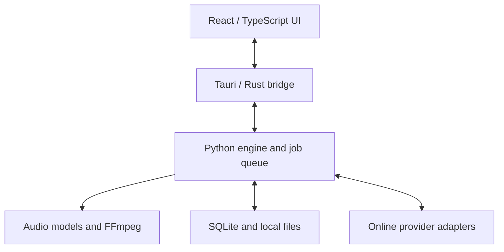

# CrateLoom — Coding Agent Handoff

Version: 1.0 · 2026-11-03

## Start here: implementation prompt

You are the coding agent implementing **CrateLoom**, a local-first, all-in-one DJ music-preparation desktop application. Treat this document as the product brief, architectural baseline, and acceptance criteria. Build working software, not just a visual mockup or an implementation plan.

Read the repository and applicable project instructions first. Preserve existing work. If the repository is empty, scaffold it. Briefly explain your implementation plan, then execute incrementally. Make routine engineering decisions yourself; ask only about genuinely blocking choices, destructive actions, credentials, or decisions that substantially change scope. Do not replace the agreed stack without explaining a concrete incompatibility.

The agreed stack is **Tauri + React + TypeScript + a Python sidecar**, with a thin Rust integration layer, SQLite, FFmpeg/ffprobe, and local audio analysis. No required LLM, cloud backend, account, subscription, or API key. Prioritize macOS on Apple Silicon, preserving a cross-platform design for Windows. The owner has previous Tauri experience and prefers its lighter shell.

Implement the milestones below in order, continuing through feasible work without requesting approval at every stage. Begin with the risky vertical slice: local track → real analysis → editable cue preview → rekordbox XML export. Do not stop after scaffolding or a dashboard with placeholder data. If a platform, provider, or model blocks one capability, report the specific limitation and continue independent work. Never fabricate analysis, metadata, download success, or verification results.

Keep a short progress document in the repository with completed features, reproducible commands, decisions, measured results, and remaining blockers. At handoff, summarize what works, how to run it, what was tested, and what still needs real-device verification. Do not publish a release or purchase services merely because this document discusses future distribution.

## 1. Product intent

**Name:** CrateLoom

**Working tagline:** Your music, ready for the decks.

CrateLoom brings discovery, acquisition from supported sources, metadata cleanup, audio analysis, automatic cue suggestions, cue preview/editing, and DJ-library export into one workspace. It is primarily a personal tool, designed so it can eventually be released as open source.

The target user DJs with rekordbox and wants less repetitive track preparation. This is a preparation application, not a full replacement for rekordbox or a live-performance DJ engine.

### Main user journey

1. Drop local audio files/folders into the application, paste a supported song URL, or search by song name.
2. For online inputs, identify candidate recordings and permitted acquisition options. Show the actual source, version, duration, and availability.
3. Import or download the selected file; preserve its provenance and quality information.
4. Propose cleaned title, artist, release/album, and artwork; analyze tempo, beats, and song structure.
5. Generate cue suggestions using a selectable preset.
6. Preview cues on a waveform, audition transitions, edit cues, and save the result.
7. Export tagged audio when requested and a rekordbox XML playlist referencing the correct files.

Local-file preparation must remain fully usable when online providers are unavailable.

## 2. Scope and priorities

### Required first usable release

- File/folder import, library search, duplicate handling, missing-file status, and relinking.
- Real playback, waveform overview and detail, A–H hot cue preview, pre-roll audition, basic looping, manual cue creation/editing, undo/redo.
- Local beat/tempo analysis, structure analysis when an evaluated model is available, and preset-based cue suggestions.
- Persistent manual edits, cached analysis, job progress/cancellation, actionable errors.
- Metadata inspection and editing; candidate-based online matching and artwork lookup.
- Explicit tag writing and safe export; rekordbox XML export with documented import steps.
- URL/name discovery and at least one genuinely working permitted acquisition path, with other provider limitations explicit.
- Packaged macOS build, or an accurately documented packaging blocker plus a reproducible development build.

### Later extensions, not prerequisites

- Optional natural-language assistant that calls existing application services.
- Additional download/metadata/analysis adapters.
- Other DJ-software export formats, playlist planning, two-track transition preview.
- MIDI mapping, advanced time-stretching, stems, personalized cue learning.

Do not build cloud sync, a hosted music-storage service, a social network, a multiagent framework, or a full two-deck performance engine for V1.

## 3. Architecture



### Ownership boundaries

- **React:** library, metadata review, waveform visualization, transport, cue editing, job presentation, settings. Keep audio playback responsive while analysis runs.
- **Rust:** approved native dialogs/file access, sidecar lifecycle, typed command routing, restricted local audio access. Avoid duplicating Python business logic.
- **Python:** library application services, SQLite migrations and writes, metadata matching, analysis, cue rules, provider adapters, exports, durable jobs.
- **SQLite:** authoritative structured library state. Python is its sole application writer. The renderer never accesses it directly.
- **Filesystem:** original tracks, optional managed copies, derived previews/peaks, analysis caches, model files, export artifacts, backups.

Prefer one application-managed sidecar and a small bounded worker pool. Start with one heavy analysis job at a time; allow lightweight UI operations and cancellation while it runs. Use a separate worker process for expensive/model operations when needed to make cancellation and recovery reliable.

### Sidecar transport

Use a versioned JSON Lines protocol over stdin/stdout, mediated by Rust. A request includes `protocol_version`, `request_id`, `method`, and validated `params`. A response contains the matching ID and either a result or a structured error. Job events include `job_id`, state, stage, and optional progress.

Reserve stdout for protocol messages; send logs to stderr. Handle partial reads, malformed messages, bounded message sizes, startup failure, crashes, timeouts, and shutdown. A handshake reports engine version and capabilities. Long-running requests return a job ID promptly.

Example methods: `library.import`, `library.list`, `track.get`, `metadata.search`, `metadata.apply`, `analysis.enqueue`, `cues.generate`, `cues.save`, `jobs.cancel`, `export.rekordbox`, `providers.search`, `providers.acquire`.

Do not send audio bytes or huge waveform arrays through JSON IPC. Return scoped asset references and cached peak references. Choose and validate a Tauri-compatible local asset-serving method with seeking/range behavior. Do not expose arbitrary filesystem paths through an unrestricted URL handler.

No local HTTP server is required by default. If one is technically necessary, bind only to loopback, use an ephemeral port/session token and restrictive origin handling, and document the reason.

## 4. Suggested repository layout

```text
apps/desktop/                  React UI and Tauri shell
apps/desktop/src/              UI features and typed client
apps/desktop/src-tauri/        Rust bridge and packaging
engine/crateloom/              Python package
engine/crateloom/library/      Import, identity, metadata, persistence
engine/crateloom/analysis/     Model adapters and audio processing
engine/crateloom/cues/         Presets and cue generation
engine/crateloom/providers/    Discovery and acquisition adapters
engine/crateloom/exporters/    Rekordbox XML and portable export
engine/crateloom/protocol/     IPC validation and dispatch
engine/tests/                 Meaningful unit and integration tests
packages/contracts/           Protocol schemas and shared definitions
docs/                         Architecture, setup, verification, licenses
scripts/                      Development and packaging helpers
```

Adapt this layout to the repository rather than restructuring existing work gratuitously. Pin compatible dependencies and commit lockfiles. Prefer generated or contract-tested TypeScript/Python schemas to divergent handwritten interfaces. Select a Python version compatible with the chosen audio dependencies rather than blindly choosing the newest release.

## 5. Track identity, storage, and data model

Use stable internal UUIDs. A path is a location, not track identity. Distinguish an exact file hash, an audio-content signature, and an acoustic fingerprint: they answer different questions. Tag changes may change the whole-file hash without changing the audio; do not invalidate audio analysis merely because artwork was updated.

Suggested entities:

| Entity | Core fields |
| --- | --- |
| Track | ID, locations, display metadata, duration, format, acquisition provenance, added/updated timestamps |
| Audio asset | ID, track ID, path, file identity, audio signature, sample rate, channels, codec, reported bitrate, timeline version |
| Metadata candidate | Source/IDs, title, artists, version, release, artwork reference, match evidence, review state |
| Analysis run | Asset ID/signature, engine/model version, parameters, status, timings, beats, downbeats, sections, warnings |
| Cue | ID, track/asset ID, slot, kind, position, optional loop end, label, color, origin, edit state |
| Cue proposal | Analysis run and preset version, proposed markers, reasons, optional calibrated confidence |
| Playlist | ID, name, ordered track IDs |
| Job | ID, type, input reference, state, stage, progress, error, timestamps |
| Settings | Library paths, cue presets, analysis options, provider preferences |

Store large derived arrays in cache files when appropriate. Analysis cache keys include audio identity, analysis/model version, and relevant parameters. Persist schema versions and use migrations.

Original files remain untouched on import. Default to referencing them; offer an explicit managed-copy option. Keep temporary work separate from originals. Support Unicode, spaces, external drives, missing media, and Windows paths. Never delete a source file when removing a track from the library.

Maintain suggestions separately from accepted/manual cues. Reanalysis must not overwrite manual edits. Applying a new preset should present proposed changes and preserve protected cues. Cue edits need undo/redo and persistence across restart.

## 6. Audio analysis and timeline correctness

### Analysis layers

1. Inspect/decode audio, determine actual duration and codec, compute peak data.
2. Estimate tempo, beats, and downbeats.
3. Infer structural boundaries and labels using an evaluated local model.
4. Apply deterministic musical rules to create cue proposals.

Evaluate All-In-One Music Structure Analyzer as an initial candidate. Do not assume effortless Apple Silicon acceleration, Windows installation, redistribution rights for every dependency/weight, or acceptable memory usage. Prove installation and analysis on representative files. Keep it behind an `AnalysisProvider` interface with capability reporting.

Provide a baseline beat-analysis/manual-editing mode if semantic analysis is unavailable. Label missing functionality accurately; do not create fake verse/chorus labels from fixed intervals. Do not call every chorus a drop. Drop detection, if offered, requires separate supporting evidence and validation.

No training pipeline is required. No LLM is responsible for beat timing or factual metadata.

### Canonical timeline

Define a canonical decoded-audio timeline for each asset. Store cue positions using an explicitly documented unit and precision (for example, integer microseconds with sample-rate metadata). Convert to seconds only at playback/export boundaries.

Test MP3 decoder delay, encoder padding, variable bitrate, resampling, and differences between analysis and browser decoding. A normalized PCM preview may help consistency, but it does not automatically prove alignment with rekordbox's original-file decoder. Record transformations and any measured mapping; do not apply guessed global offsets.

Finalize acquired audio before analysis. Any trim, time stretch, or replacement creates a new timeline version and requires explicit cue migration or reanalysis. Pure tag changes must not shift the timeline.

Use beat/downbeat arrays for musical offsets. Do not assume the first audible sound is beat one or that one global BPM describes every track. Half/double tempo errors should be reviewable. For V1, restrict bar-based rules to a supported/confirmed meter, normally 4/4; skip them or ask for a grid correction when meter/beat structure is unknown.

## 7. Cue generation and editing

Provide a configurable preset system. Begin with a conservative four-cue preset and an optional extended A–H preset. Do not fill every slot merely to make the result look complete.

Example optional mapping:

| Slot | Proposed role |
| --- | --- |
| A | First usable intro downbeat |
| B | First verse or supported vocal-entry estimate |
| C | First detected chorus; drop only if separately supported |
| D | Sixteen bars before C, if valid |
| E | Later contrasting section/breakdown when supported |
| F | Next chorus/drop candidate |
| G | Usable outro start |
| H | User-defined marker or reviewed loop |

Rules:

- Resolve candidates against the actual beat grid; snap only within a documented tolerance.
- Reject negative or out-of-duration positions; skip impossible pre-roll cues rather than clamping them into duplicates.
- Deduplicate markers using a documented proximity rule.
- Section detection does not prove a section is suitable for mixing; make that a reviewable suggestion.
- Explanations should be traceable, such as “16 bars before Cue C,” not invented confidence claims.
- If a provider lacks calibrated confidence, use “needs review” or expose evidence rather than fabricated percentages.
- Loops need explicit start/end positions and a supported beat/bar length. Do not assume all tracks admit a seamless safety loop.

Users can create, move, rename, recolor, delete, and reorder cues; choose snapping off/beat/bar; and override section labels. Cue slot order need not equal chronological order.

## 8. Interface and playback

Design a focused desktop workspace, initially dark-themed, with readable typography, keyboard navigation, visible focus, and labels alongside colors. Avoid a marketing landing page or ornamental dashboards.

### Layout

- Sidebar: Library, playlists, imports/jobs, export, settings.
- Track table: artwork, title, artist, version, BPM, key if genuinely analyzed, duration, preparation state, source.
- Selected-track workspace: metadata review, full waveform overview, zoomed detail, beat/bar markers, section labels, cues.
- Transport: play/pause, seek, volume, current/duration time, loop toggle, A–H cue buttons.
- Review tools: generate proposals, accept/edit, compare metadata candidates, save, export.

### Required playback behaviors

- **Trigger cue:** seek to the cue and play; it is an audition feature, not a promise of performance-grade controller latency.
- **Check cue:** start a configurable number of beats before it and play through it. Use seconds as a clearly labeled fallback when beats are unavailable.
- **Loop preview:** loop a selected beat/bar range; cancellation must be immediate and predictable.
- **Drag marker:** update the visible position, apply selected snapping, and persist through an explicit edit transaction.
- Keyboard shortcuts must not fire while typing in metadata fields. Display mappings in the UI.

Use WaveSurfer for visualization, with an explicit playback abstraction. Evaluate native media playback versus Web Audio for the required accuracy. Do not assume HTML media seeking or timer-based looping is sample accurate. Avoid loading an entire library as decoded PCM; cache peaks, decode the selected asset as needed, and release unused buffers. If seamless loops need a different playback backend, isolate that change behind the abstraction.

Show loading, empty, missing-file, model-unavailable, failed-analysis, and offline states. Do not silently freeze or substitute demo data for real results.

## 9. Metadata and artwork

Read existing tags first. Implement manual editing even before online matching is complete. Evaluate MusicBrainz/AcoustID for identity and Cover Art Archive for artwork, subject to current service requirements, attribution, limits, and licensing.

Use multiple matching signals: artist/title, duration, version, existing identifiers, and fingerprint where available. A fingerprint can identify a recording without proving a particular album release. Preserve remix, extended/radio edit, instrumental, clean/explicit, and live distinctions.

Show candidate metadata with source and matching evidence. Allow ambiguous candidates to remain unresolved. Never overwrite unknown fields with invented values. Album and artwork should correspond to the selected release, not simply the first image result. Fetch and cache images with bounds on size/type.

Separate metadata lookup from tag writing. Show an apply diff; support multi-track changes with explicit scope. Preserve unrelated tags where possible. Use a proven tagging library such as Mutagen after checking supported formats. Start with MP3; expand to formats actually tested. Use safe temporary writes/backup behavior and verify results. A generated title must not silently rename or relocate the source file.

## 10. Discovery and acquisition

Expose adapters with explicit capabilities: URL resolution, text search, metadata lookup, acquisition, supported formats, and authentication requirements. A song-reference link is not necessarily a downloadable audio source.

- **Local files:** always supported.
- **Direct artist/authorized download links:** implement a bounded, reliable route where supported.
- **YouTube/YouTube Music/SoundCloud:** evaluate yt-dlp or official mechanisms for supported, permitted acquisition. Do not promise universal access. Handle unavailable/private/geoblocked content as clear states.
- **Spotify:** reference/discovery only unless an officially permitted file-acquisition capability actually exists. Do not implement DRM bypass or stream ripping. Do not label audio fetched from another service as a Spotify download.

For name searches, return candidate recordings and available sources. Do not silently select a cover, remix, live version, or another recording. Make source/version choice reviewable before acquiring audio.

Use best available source quality without claiming conversion improves fidelity. Offer MP3 conversion when requested and show source codec versus export settings. A 320 kbps output is not proof of high-quality source audio. Preserve original assets where practical.

Implement queued acquisition, cancellation, partial-file cleanup, timeouts, filename sanitization, size/duration limits, and duplicate checks. Pass subprocess arguments as arrays; never interpolate a URL or song title into shell code. Do not add automatic purchases, credential scraping, silent browser-cookie extraction, or arbitrary plugin execution.

## 11. Rekordbox integration

Use documented rekordbox XML as the first export route. Ordinary MP3 tags do not universally carry rekordbox hot cues. Export the referenced audio locations and the XML playlist as distinct artifacts.

Verify the actual XML schema and current import behavior before implementing. Include appropriate track IDs, file URLs, metadata, playlist references, and `POSITION_MARK` elements for supported cues/loops. Map A–H slots explicitly and distinguish hot cues from memory cues. Validate XML escaping, file-URL encoding, Unicode, spaces, and path semantics per OS.

Do not directly modify rekordbox's database. Do not copy audio unless the user selects an export-with-audio option. If files are copied, rewrite references to those exact copies. Provide an export manifest and a portable CrateLoom JSON backup of cues/settings.

Decide deliberately whether to export a validated beat grid or allow rekordbox to analyze one. Document possible grid differences. Never export a fabricated constant-tempo grid over variable-tempo audio. Avoid claiming active-loop behavior unless verified in the target version.

Test new-track import and the behavior for tracks already in a collection. Supply concise user instructions and explain any overwrite/merge behavior verified. If rekordbox is unavailable in the development environment, validate XML structure/round-trip data and explicitly mark actual rekordbox import and audible alignment as pending manual verification.

## 12. Jobs, security, and reliability

Jobs need queued/running/succeeded/failed/cancelling/cancelled states, stage-aware progress, retry where safe, and recovery after restart. Report indeterminate progress when no accurate percentage exists. Cancel child processes and avoid orphaned downloads/analysis workers.

Use least-privilege Tauri capabilities and a restricted content-security policy. The renderer cannot execute arbitrary commands. Treat metadata, URLs, filenames, lyrics, and model output as untrusted content. Render text safely. Protect secrets with OS credential facilities if an optional provider later requires them; exclude them from logs and exports.

Database updates should be transactional. Write exports atomically and handle full disks, permission errors, removed external drives, corrupt audio, network failures, and engine crashes without losing manual edits. Local logs should aid diagnosis without unnecessarily exposing credentials or sensitive paths. No telemetry by default.

## 13. Packaging and open-source readiness

During development, use a documented Python environment and one command to launch the desktop application plus engine. For distribution, bundle a platform-specific Python sidecar and required utilities so users do not install Python themselves.

Prototype packaging early, especially native audio/ML dependencies. Model downloads may be optional on first use, with size, provenance, license, checksum, and removal controls. Analysis should run offline afterward. CPU fallback is required for baseline functionality; GPU acceleration is an optimization only when actually supported and tested.

Record measured app size, model size, analysis time, and peak memory on the tested hardware. Do not invent performance estimates. Tauri's small shell does not imply small ML dependencies.

Maintain a third-party inventory covering code, models/weights, FFmpeg build configuration, artwork/metadata sources, and redistribution obligations. Do not infer that a repository's top-level license covers all bundled assets. Propose an appropriate project license after inventory; do not claim legal clearance. Document macOS signing/notarization and Windows signing requirements without fabricating successful signing.

## 14. Implementation milestones

### M0 — Technical feasibility and contracts

Inspect/scaffold repo, select compatible pinned versions, establish IPC handshake, prove one real audio-analysis run, prove local playback/seek on the target webview, generate minimal schema-valid rekordbox XML, and attempt a minimal packaged sidecar. Record dependency or runtime blockers immediately.

### M1 — Working local vertical slice

Import one file, show metadata and waveform, play audio, create/edit A–H cues, persist and reload them, export XML plus portable JSON. This must work without a model or network.

### M2 — Analysis and suggested cues

Add cancellable analysis jobs, beat/section overlays, cache, presets, pre-roll audition, loop review, and suggestion acceptance. Preserve manual edits. Implement the selected real model or clearly explain a model-specific blocker with a functioning baseline mode.

### M3 — Library and metadata preparation

Add folder/batch import, library table/search, duplicates/relinking, playlists, candidate metadata matching, artwork, explicit tag writing, and batch review.

### M4 — Online discovery and acquisition

Add URL/name input, adapter capability states, source/version selection, at least one verified acquisition path, queue/retry/cancel, and quality/provenance display. Unsupported providers must fail honestly, not appear complete.

### M5 — Export, packaging, and release readiness

Complete export edge cases, real rekordbox checks where available, macOS bundle, cross-platform contract/path tests, Windows verification when available, setup documentation, dependency/license inventory, and a release-readiness checklist.

At each stage, keep the app runnable. Later features may be visibly unavailable until implemented; do not populate them with fabricated results. Continue to the next stage once meaningful checks pass.

## 15. Verification and acceptance

Use generated click tracks and synthetic sections for deterministic timing tests, plus user-provided or redistributable music for musical evaluation. Synthetic signals prove timing mechanics, not semantic accuracy. Do not commit copyrighted music fixtures without permission.

Required checks:

1. A track imports and plays; its manual cues survive restart and reanalysis.
2. Bar offsets use beat/downbeat positions correctly, including boundaries and unsupported meter.
3. Preview, stored positions, and XML export share the documented timeline; XML serialization round-trip error is at most 1 ms. Measure playback/rekordbox alignment separately rather than claiming this proves audible accuracy.
4. All exported cue positions and loop endpoints are valid for the asset; no accidental duplicate slots.
5. Tag writing preserves unrelated metadata and audio timing; failed writes preserve originals.
6. XML correctly handles spaces, Unicode, special characters, file URLs, and relevant OS path styles.
7. Analysis/cache behavior remains correct after tag edits, audio replacement, and model-version changes.
8. Sidecar crash, cancellation, missing media, offline lookup, malformed audio, and failed acquisition produce recoverable states.
9. Library remains navigable and selected-track playback usable during analysis.
10. A packaged build starts on a clean target machine without a separately installed Python environment; if untested, mark it unverified.

Use focused Python tests for cue rules, identity/cache logic, metadata safety, export, and job behavior; frontend tests for editing state; integration tests for IPC and real local-file flow. Run formatter/linter/type checks and appropriate builds. Do not write trivial tests solely to inflate coverage.

For musical validation, review approximately 20–30 representative tracks when available. Record cue acceptance/edit rate, beat/downbeat mistakes, version-match mistakes, preparation time, analysis time, and memory. Do not invent an accuracy percentage or impose a genre-specific success claim before this evaluation.

### Final coding-agent delivery

- Runnable source and lockfiles.
- Exact development and build commands.
- Concise architecture and protocol documentation.
- Actual dependency versions and licensing inventory.
- Test/build results and platform coverage.
- Rekordbox import instructions and verification status.
- Completed vs partial vs blocked feature list, with no ambiguous “done” claims.
- Recommended next work based on observed limitations.

## 16. Reference starting points

These are candidates and technical references, not a guarantee of compatibility or redistribution permission. Verify current official documentation and pin tested versions during implementation.

- Tauri documentation: https://v2.tauri.app/
- Tauri sidecars: https://v2.tauri.app/develop/sidecar/
- WaveSurfer: https://wavesurfer.xyz/
- Web Audio API: https://developer.mozilla.org/en-US/docs/Web/API/Web_Audio_API
- All-In-One Music Structure Analyzer: https://github.com/mir-aidj/all-in-one
- Essentia, alternative analysis building blocks: https://essentia.upf.edu/
- FFmpeg: https://ffmpeg.org/documentation.html
- Mutagen: https://mutagen.readthedocs.io/
- MusicBrainz API: https://musicbrainz.org/doc/MusicBrainz_API
- AcoustID: https://acoustid.org/webservice
- Cover Art Archive API: https://musicbrainz.org/doc/Cover_Art_Archive/API
- yt-dlp: https://github.com/yt-dlp/yt-dlp
- Rekordbox XML specification (older official reference; verify against installed version): https://cdn.rekordbox.com/files/20200410160904/xml_format_list.pdf
- pyrekordbox XML documentation: https://pyrekordbox.readthedocs.io/en/latest/formats/xml.html
- Existing cue-import workflow reference: https://mixedinkey.com/workflows/export-cue-points-to-rekordbox/
- Spotify developer terms: https://developer.spotify.com/terms

## Immediate next action

Inspect the workspace, identify the existing project state, and implement M0 followed by the local vertical slice. Report measured feasibility findings as you go. Keep the agreed product scope visible, preserve working behavior, and continue until the requested implementation is complete or a concrete external dependency blocks further work.
