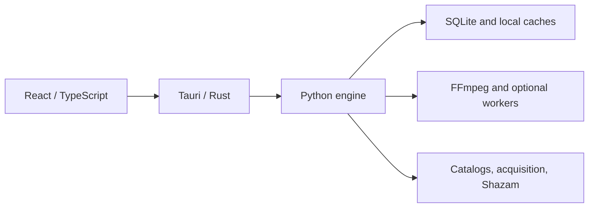

# CrateLoom Project Handoff

Snapshot: 2026-11-12, Asia/Taipei. This document describes the current working tree and the latest installed local build. It separates implemented behavior, observed results, and remaining work.

## 0. Update, 2026-11-13

Read [the November 13 verification note](docs/UX_SCAN_FIXES_VERIFICATION.md) first; where it and this document differ, it is newer.

- The whole working tree described below is now committed, with later fixes, on branch `ux-scan-fixes` (not pushed; `main` is unchanged). The installed app is still the November 12 build.
- Section 6: the generic failure seen with a selected browser was an unreadable browser session reported as a connection problem. That is fixed and tested with fixtures; an anonymous scan of the supplied mix now shows the age-verification message beside the YouTube access control. Reading a real browser session is still unverified and still needs the owner's own run.
- New engine methods: `playlists.delete`, `library.remove`, `acquisitions.clear_failed`. Analysis version is `librosa-0.11.0-grid-7`: beat analysis fits a constant-tempo grid and detects the key (Camelot).
- The frontend was split: `main.tsx` holds state and engine calls; views are in `LibraryView.tsx`, `CueEditor.tsx`, `PlayerBar.tsx`. Engine calls go through `engine.ts`.
- `scripts/preview-browser.mjs` runs the interface in a browser against a real engine and a disposable library (`CRATELOOM_DATA` is required).
- Baseline is now 170 Python tests, 14 frontend tests, 2 Rust tests, and the interaction harness passing in Chromium and WebKit.

## 1. Overview And Product Goal

CrateLoom is a local-first desktop application for preparing music for DJ use, with rekordbox as its first export target. Its purpose is to reduce the repetitive work between finding a recording and having a usable, organized, analyzed track in a DJ library.

The intended workflow is:

1. Import local files/folders, find a recording, or start from a song, playlist, or DJ-set link.
2. Establish the recording's title, artist, version, duration, source, and availability.
3. Acquire supported audio, or associate an existing local file.
4. Clean metadata and artwork; analyze tempo, beats, waveform colors, and approximate sections.
5. Generate and review cues, audition the audio, and correct the grid and preparation details.
6. Arrange a playlist and export its audio references or verified copies, cues, metadata, and reviewed fixed grids to rekordbox XML.

The primary user is a DJ who wants one practical preparation workspace. macOS on Apple Silicon is the current development and verification platform. Windows remains a future target. The original brief also anticipates eventual open-source distribution, but the current delivery is a local development/test application.

Local preparation should remain usable without online providers once the necessary local runtimes are installed. No hosted backend, mandatory LLM, subscription, or general CrateLoom account is required for that workflow. Individual online services can require their own account access.

CrateLoom is not a two-deck performance engine or a full replacement for rekordbox. Cloud music storage, social features, advanced time stretching, MIDI mapping, stem performance, and other DJ export formats are outside the present baseline.

## 2. Current Development And Delivery State

- Application version remains `0.1.0`.
- The latest Git commit is `9cd834b`, "Document M2 acceptance, verification, and M3 priorities". The working tree contains substantial later implementation, including M3-M5 work and the recent metadata, set-import, interface, and YouTube changes.
- Many important frontend components, engine modules, tests, scripts, and verification documents are still untracked. A checkout of committed HEAD alone will not reproduce the current application. Preserve and eventually commit the complete working tree.
- An Apple Silicon macOS bundle is installed at `/Applications/CrateLoom.app`. Its main executable, frozen engine, and YouTube helper match the latest installation receipt at the time this handoff was written.
- The app is ad-hoc signed and its signature verifies. It is not a Developer ID signed/notarized public release.
- The previous installation is backed up at `/Users/melvin/Library/Caches/CrateLoom/installed-backups/CrateLoom-20261112-195215.app`.
- Installation did not terminate the owner's existing app processes. Quit all older copies before opening the update; an already running process continues to execute the old version.

The original November 3 brief, [CrateLoom_Coding_Agent_Handoff.md](CrateLoom_Coding_Agent_Handoff.md), remains useful for product intent and acceptance criteria. Its implementation instructions and proposed features are historical context. This document and the current source describe the actual baseline.

## 3. Implemented Feature Sets

### 3.1 Library, Files, And Playlists

- Single-file, multi-file, and recursive folder imports, with progress, cancellation, per-file results, and duplicate handling.
- SQLite-backed library search, missing-file detection, and identity-checked relinking.
- Original local audio is referenced by default. Importing and ordinary preparation do not rewrite it.
- Ordered playlists, naming, membership changes, and saved order used by playback and export.
- Pointer-based drag handles, keyboard Up/Down movement, and move buttons for playlist and set rows.
- Stable internal track/entry identities. Reordering changes the displayed position and saved ordering, not the internal identity used by work already in progress.
- Stale background refreshes cannot overwrite a newer reorder; failed order saves restore the prior order.

### 3.2 Playback, Waveforms, Cues, And Grids

- A bottom player with seeking, volume, shuffle/repeat, previous/next, and loading/cancellation feedback.
- Clicking the player's artwork, title, artist, or Edit button opens Cue Editor.
- Overview and detailed waveforms, frequency-colored rendering, zoom, display-frame scrubbing, and an interpolated playback clock.
- A-H hot cues with labels, colors, precise time editing, waveform marker dragging, undo/redo, beat/bar snapping, pre-roll audition, and basic loop preview.
- Adjustable beat jumps, including fractional beats through 64 beats.
- Local BPM/beat analysis, editable BPM, grid nudging, and an explicitly confirmed bar-1 anchor.
- A completed display grid across gaps in detection. Display completion does not replace the original detector evidence used for analysis decisions.
- Playback selection avoids the old whole-file hashing delay. Unsupported webview formats can use a cached PCM WAV compatibility copy; the source recording is preserved.

### 3.3 Audio Analysis And Sections

- Optional local librosa-based beat/BPM/RGB analysis in a separate cancellable worker, with versioned analysis caches.
- Fast sections based on local energy and texture changes, with editable boundaries and approximate labels such as Intro, Break, Up, Down, Outro, and Other.
- An optional, slower detailed structure-model route using the separate inference environment and source separation.
- Automatic cue generation that preserves existing cues and manual edits rather than replacing them indiscriminately.
- Progress, cancellation, model capability reporting, and explicit failure states.

Fast sections is a responsiveness improvement, not a reproduction of rekordbox's proprietary analysis. It does not identify vocals, verses, or choruses semantically. Representative musical accuracy remains a review task.

### 3.4 Metadata And Artwork

- Manual title, artist, album, genre, release-date, and artwork editing.
- Independent Apple Music catalog and MusicBrainz searches, with incremental results so an unavailable provider does not block the other.
- Filename cleanup and featured-artist normalization, including formats such as `Flo Rida,T-Pain`.
- Candidate ranking using title, artist, version/remix compatibility, duration, and release details. Incompatible candidates are excluded from selection.
- Release-aware Apple artwork and Cover Art Archive retrieval, plus local JPEG/PNG images.
- Auto metadata for selected tracks, or all tracks in the current filtered library/playlist view when nothing is selected.
- Automatic application requires an eligible match and a downloaded, validated cover. Missing artists, weak matches, or unusable covers remain for review.
- Saved candidate results, chosen source, fields, and artwork reopen through Review without another search and survive restarting.
- Metadata review has previous/next arrows that save before navigating. A failed save keeps the same track and edited fields. Old lookup polling is cancelled when the reviewed track changes.
- Changes are staged in the library. Write tags is the separate, explicit source-file modification operation, with revision checks, verified backups, and audio-identity verification.

The current automatic eligibility checks include rank at least 85, title and artist similarities at least 0.9, an album, and a recording ID. Strong matches take priority. The batch can try several compatible releases for artwork without accepting a substantially worse recording match. These scores are heuristics, not probabilities or acoustic proof.

### 3.5 Discovery And Acquisition

- Reviewed direct public HTTPS audio downloads.
- Public YouTube/YouTube Music song resolution and acquisition through yt-dlp when accessible.
- A persistent download queue with bounded concurrency, byte progress, cancellation, retry, quality details, source provenance, verification, import, and automatic analysis handoff.
- Up to ten source suggestions per set entry, with durations, service icons, compatible-version checks, and recommendation reasons.
- Recommendations favor compatible extended mixes/audio releases over redundant music-video versions when evidence supports that preference.
- Sole compatible sources can apply automatically; recommended sources can be applied in a batch.
- Source choices are independent background jobs, allowing work on other entries while a source is being checked.
- Spotify supplies recording and playlist references, not Spotify audio extraction.
- SoundCloud has references and an optional authenticated creator-enabled original-download route. Live authenticated SoundCloud acquisition remains unverified.

A reference link is not automatically an obtainable audio file. A recognized song is not proof that a specific remix/edit is downloadable.

### 3.6 DJ Sets And Service Playlists

- YouTube descriptions, chapters, timestamped pasted tracklists, and bounded recovery of coherent published comment tracklists.
- Numbered entries and timestamps at either the beginning or end of a line.
- Service playlist ingestion for supported YouTube/YouTube Music, Spotify, and SoundCloud sources.
- Optional ShazamIO recognition of a single YouTube mix or a local mix file when a useful published list is unavailable, or when audio scanning is explicitly requested.
- Saved set reports with evidence, approximate positions, unresolved ranges, candidate sources, artwork, track durations, and playlist/download associations.
- Published named chapters are preserved even without an artist credit or when audio recognition fails.
- Background cover retrieval and carry-through of covers to prepared/downloaded library tracks.
- Separate report and playlist concepts: a report can retain unresolved/repeated entries, while the prepared playlist contains available library tracks and deduplicates repeated track identities.
- Centred phase-specific progress, Cancel scan, saved matches/sample plans/checkpoints, History, Current set, and explicit Resume.
- History and report navigation remain available during scanning; completion does not force the user away from the view they are browsing.
- Explicit cancellation disables automatic continuation and remains paused after restart.

The actual recognition integration is ShazamIO. Older mentions of ACRCloud are stale. An experimental native ShazamKit probe exists in `scripts/shazam-pilot.swift`; it is not the production recognition path.

### 3.7 Export

- Single-track, selected-track, and ordered-playlist rekordbox XML export.
- A-H hot-cue slots, timestamps, names, and RGB fields, plus supported metadata.
- Cue/settings JSON backup and an integrity manifest with hashes and recovery information.
- Optional verified, byte-identical audio copies beside the XML through Include audio files.
- Confirmed fixed 4/4 grids can export `AverageBpm` and one `TEMPO` entry when the BPM, origin, and explicit bar-1 anchor pass validation.
- Estimated/unconfirmed or variable grids are not exported as confirmed fixed grids.
- Missing/replaced audio and destination collisions stop export; normal failures roll back artifacts created by that job.

rekordbox has accepted the generated XML source in native checks. Full collection import, updates to existing collection tracks, audible cue alignment, and long-track drift remain unverified. XML generation is not proof of a successful collection import.

### 3.8 Interface And Branding

- Monochrome application chrome with light/dark/system appearance, preserving meaningful waveform, cue, section, and recommendation colors.
- Current source branding is the Crate Dig mark: a record lifted from a crate. Use the checked-in SVG/PNG/ICNS assets, not older concept descriptions in the conversation.
- No repeated logo/wordmark inside the sidebar; the mark and name are in the custom title area.
- Persistent sidebar resize/collapse behavior, with the toggle beside the native traffic lights.
- Native traffic lights aligned with the 40px titlebar, and no duplicate custom maximize handler alongside Tauri's built-in behavior.
- Grouped library controls, selection-action and export-settings dropdowns, correctly labeled checkboxes, shared animated disclosures, dialog entrance/exit motion, and metadata surface morphing.
- Shared artwork/text movement into Cue Editor where View Transitions is supported, with a fade fallback and reduced-motion handling.
- Minimum native size of 600x520 for smaller tiles.

Keep the established compact desktop visual language. The supplied ICNS has separate small-size drawings; the progress notes explicitly warn against replacing it with a generic `tauri icon` regeneration.

## 4. Architecture And Ownership



| Layer | Responsibility |
| --- | --- |
| React/TypeScript | Workspace state, playback, waveform drawing, editing interaction, job polling, and presentation. |
| Tauri/Rust | Native dialogs, restricted command/file access, external-link allowlist, engine startup/shutdown, and asset-scope grants. |
| Python host | Application services, validation, identity, SQLite writes, job coordination, providers, and export. |
| Separate workers/tools | Expensive analysis, compatibility audio, tag writing, extraction/download handling, and recognition. |
| SQLite/filesystem | Authoritative structured state, caches, journals, acquired audio, reports, and backups. |

Transport is protocol-v1 JSON Lines over stdin/stdout. Requests carry `protocol_version`, `request_id`, `method`, and `params`; responses return a result or structured error with the matching request ID. Stdout is reserved for protocol output. Rust holds one engine connection behind a mutex. Long work normally returns a job ID and is polled through the existing endpoints.

Current examples include `metadata.batch.start/get/cancel`, `metadata.search/job`, `sets.scan`, `sets.cancel_task`, `sets.cancel_scan`, `sets.resume_scan`, `sets.auto_scan`, `sets.reorder`, `sets.prepare`, `sets.add_source`, `playback.prepare`, and `export.enqueue`.

Background execution is not one unified durable queue. Different features have different persistence policies. General analysis queue state is partly frontend/session state; metadata batch journals and set recognition checkpoints have their own restart behavior. The download manager currently has four workers with a per-source limit of three; provider/source work also uses bounded pools. Older descriptions of a strictly serial acquisition queue are stale.

| Work type | Restart behavior to preserve |
| --- | --- |
| Downloads | Queued work can resume; transfers that were active become interrupted and can be retried. |
| Folder/file imports | Completed file results remain saved; interrupted batches ask for the files/folder again. |
| Auto metadata | Completed review results persist; unfinished batch work is reported as interrupted rather than silently resumed. |
| Set audio recognition | Enabled continuation can resume from stored checkpoints/plans; explicitly cancelled work remains paused. |
| General analysis/provider work | Do not assume the frontend waiting list or in-memory provider job IDs survive a restart. |

Online catalog searches send query metadata to providers. Mix recognition decodes windows locally and uses ShazamIO to submit recognition fingerprints to Shazam. These online operations are separate from offline local analysis.

## 5. Data, Identity, And Safeguards

Default application data is `~/.crateloom`. `CRATELOOM_DATA` selects another library and must be set before engine startup. Use an isolated root for fixtures, source tests, and destructive experiments.

Important storage includes:

| Location/entity | Purpose |
| --- | --- |
| `library.sqlite3` | Tracks, cues/sections, analysis jobs, ordered playlists, imports, acquisitions, and set reports/checkpoints. |
| `analysis-cache/` | Versioned waveform, beat, RGB, and section outputs. |
| `artwork/` | Managed validated images. |
| `downloads/` and `acquisition-work/` | Published acquired files and separate partial work. |
| `playback-cache/` | Derived webview-compatible WAV files. |
| `metadata-cache/`, `metadata-review/`, `metadata-batch/` | Catalog caches, saved review candidates, and batch journals. |
| `set-audio/<video-id>/` | Verified recognition-input mix audio, source manifests, and attempt outcome categories. |
| `tag-backups/` and `tag-receipts/` | Verified source-file backups and tag-write recovery evidence. |

`PRAGMA user_version` is currently 11. Some feature tables are created by feature schema helpers without changing that counter; do not assume the version alone describes every table. Set state includes `dj_sets`, `dj_set_items`, `dj_set_scan`, `dj_set_auto_scan`, `dj_set_scan_work`, `dj_set_history`, and `dj_set_youtube_access`.

Preserve these invariants:

1. Python owns application database writes; the renderer does not edit SQLite directly.
2. Track/entry UUIDs are stable. File paths and displayed order numbers are not identities.
3. Cue and section positions use integer microseconds on the decoded-media timeline.
4. Exact-file SHA-256, compressed-audio identity, and acoustic recognition have different purposes. A Shazam match does not replace file-integrity checks.
5. Import, analysis, compatibility conversion, and ordinary export preserve original audio. Explicit tag writes use verified temporary copies/backups and do not reencode the audio.
6. Reanalysis and concurrent background operations must preserve human edits. Stale saves/reviews are rejected or skipped.
7. Never silently replace the requested mix with another upload or claim a different edit is the exact recording.
8. Preserve completed entries, matches, and checkpoints on cancellation. An explicit user cancellation must not become an automatic resume after restart.
9. Keep tokens, cookies, signed CDN URLs, and authentication headers out of persisted diagnostics and handoff evidence.

## 6. Current Main Problem: The Supplied YouTube Mix

### 6.1 User Goal And Exact Reproduction

The user wants reliable DJ-set ingestion: paste a YouTube mix, obtain published entries or identify its audio, prepare an ordered playlist with artwork and usable sources, and keep working while the scan progresses. The most urgent complaint is repeated generic YouTube fetch failures.

The supplied failing link is:

`https://youtu.be/LTFCuhofnN8?si=MrisMwzY7hMIdeN5`

It normalizes to:

`https://www.youtube.com/watch?v=LTFCuhofnN8`

Observed identity: **Siangyoo |High-Energy| Hip-Hop, R&B, Edits 014**, duration **1,867 seconds / 31:07**.

### 6.2 What Was Actually Observed

- The public page supplied the title and duration.
- No usable description, chapter, or bounded-comment tracklist was recovered in the last test. This is an observation of the available responses, not proof that a list can never become available.
- All attempted public audio connections returned an age-verification requirement.
- The packaged engine reproduced this from the exact short URL and returned: `YouTube requires age-verified access to this mix. Choose your signed-in browser under Options, then retry.`
- That initial scan failed before mix audio was acquired. There is no verified successful audio download or complete recognition result for this video.
- The user was offered an authorized browser-session test and answered **"I'll choose it in the app."** No browser cookies/session were accessed during the live tests. Do not assume authorization to inspect browser profiles on their behalf in a later session.

The immediate remaining step is an owner-initiated authenticated scan in the app, using a browser/account that can actually play this age-restricted video on YouTube. The signed-in route is implemented and fixture-tested; successful authenticated acquisition of this exact video is **not yet verified**.

Owner reproduction: quit older copies, open `/Applications/CrateLoom.app`, paste the link in **Import DJ Set**, choose **Options > YouTube access**, select the signed-in browser, and click **Scan**. Access failures now expand Options automatically. The browser/account must already be eligible to play that video on YouTube.

### 6.3 Recovery Work Already Implemented

1. The macOS build includes a checksum-pinned official yt-dlp 2026.10.26 helper. Deno remains separately installed. Explicit `CRATELOOM_YT_DLP` overrides are supported.
2. Public-page metadata extraction is independent of audio extraction; full descriptions, chapters, several timestamp formats, and coherent comment lists can supply entries.
3. A valid, hashed cached mix is reused when available.
4. New acquisition prefers yt-dlp's own transfer handling. It then tries direct WebM/Opus-oriented resolution, direct M4A resolution, and another native-transfer client.
5. The final public client is `web_safari`; an explicitly selected browser session uses `web` for that final attempt.
6. Native transfer supports segmented streams and a supported low-resolution muxed fallback. FFmpeg can copy the audio stream into a separate analysis file without reencoding.
7. Identity, duration, stream type, size, and hash are checked before caching. Transfers have time/progress bounds and cancellation.
8. A client-specific age warning does not prematurely stop every remaining connection. Errors distinguish age, region, private/removed/member access, bot/sign-in challenges, and connection expiry/failure.
9. The app opens Options after a relevant access error. Public access remains the default. Safari, Chrome, Firefox, and Edge can be explicitly selected.
10. The browser name enters `ScanControl.youtube_browser`, becomes `--cookies-from-browser <browser>` for the scan, and can be stored in `dj_set_youtube_access` for report continuation. CrateLoom does not persist a cookie export.

Current mix-audio attempt order is implemented in `scan_audio.obtain()`. Helper discovery, Deno/browser arguments, and error classification are in `youtube_audio.py`. The browser choice is a DJ-set scan setting, not a general account manager for all Find Music/download operations.

### 6.4 Keep The Failure Layers Separate

| Stage | Meaning and independent failure modes |
| --- | --- |
| Published list extraction | Can succeed even when audio access fails. A public title alone is not a tracklist. |
| Exact mix audio acquisition | Can fail from sign-in/age/region access, stale extraction, HTTP 403, or transfer problems. |
| Shazam recognition | Requires acquired audio; catalog coverage, overlaps, edits, and rate limits can prevent complete identification. |
| Per-song source selection | A recognized title may not have an obtainable source for the exact remix/edit. |
| Playlist/import/analysis/export | Depends on verified local tracks and must preserve saved ordering, artwork, cues, and provenance. |

Fixing mix acquisition is not proof that every recording is recognized or that every identified edit can be downloaded. Conversely, a successful scan with no recognized recordings is no longer reported as an audio-fetch failure; unidentified ranges remain reviewable.

### 6.5 Live Evidence From Other Mixes

| Video | Observed result |
| --- | --- |
| `HHloSWHKdvw` | Recovered 52 published entries. Fully downloaded and validated 3,783 seconds of WebM, 28,737,378 bytes. Direct CDN transfers returned 403 while yt-dlp's own transfer succeeded. A fresh run after making native transfer the first choice completed in about 17.25 seconds on its first connection. |
| `uVR76AQGfdE` | Fully downloaded and validated 1,785 seconds, 14,337,225 bytes, in about 16.49 seconds. A live recognition test returned two recordings and progress through 30 seconds before Shazam rate-limited more requests. This was a partial recognition test. |
| `RSxaogPCjD8` | Exact identity and an audio format resolved. A full download was not counted as verified. |
| `LTFCuhofnN8` | Public metadata readable; no recovered usable list; anonymous audio acquisition requires age verification. Authenticated retrieval remains pending. |

These are measured examples, not throughput guarantees or universal source coverage.

### 6.6 Recommended Next Work

1. Ask for the result of the owner's in-app signed-in scan of `LTFCuhofnN8`. Confirm the same browser/account can play that exact video on YouTube.
2. If it fails, locate the failing stage before changing the transport or recognition algorithms. Inspect selected browser, helper version, Deno availability, process exit category, and sanitized attempt outcomes.
3. Verify browser session extraction on macOS, including Keychain/access prompts, expired/missing sessions, and multi-profile browser behavior. The UI currently selects a browser name and does not expose a profile picker. Do not silently scan every profile or export cookies.
4. Confirm full download completion, media validation, cache reuse, recognition handoff, cancellation, restart/continuation, and final playlist preparation for the exact video after authorized access succeeds.
5. Exercise Shazam cooldown/partial-result behavior separately from YouTube authentication. Retain useful matches and give an actionable paused/retry state.
6. Keep the interface responsive throughout; maintain History, Current set, per-row source jobs, and saved ordering.

Do not claim this issue is fully solved until the exact authenticated path is tested. Repeating anonymous requests cannot establish that an account satisfies YouTube's age gate. Private, removed, region-restricted, or ineligible-account content cannot be guaranteed obtainable by this application.

## 7. Current Limitations And Verification Boundaries

| Area | Current limitation |
| --- | --- |
| YouTube | Exact supplied age-restricted mix still needs an owner-initiated authenticated verification. Provider changes, account eligibility, region/private status, challenges, and expired sessions remain external dependencies. |
| Recognition | ShazamIO is an online recognition route. It can rate-limit or miss edits, overlaps, and niche tracks. Approximate timestamps and partial results need review. |
| Metadata | Text/duration/version heuristics do not prove exact audio identity. Bootlegs, mashups, and unpublished edits may have no reliable catalog record or cover. Embedded cover writing is unavailable for OGG. |
| Sections | Fast labels are energy/texture estimates. The detailed model is slower, uses source separation, and has unresolved weight-license questions. Neither has a broad musical-accuracy acceptance benchmark. |
| Beat grids | No automatic meter/downbeat guarantee or flexible per-beat warp editing. A confirmed fixed 4/4 grid is a narrower capability. |
| Playback | Compatibility conversion can require initial waiting and disk space. Real-world decoder offsets, MP3/VBR timing, audible cue alignment, and physical high-refresh/scrub feel are not comprehensively measured. |
| Performance | Some analysis decodes audio into memory. Large-library throughput and worst-case memory use are not production benchmarks. A fast synthetic fixture is not proof of musical quality. |
| Persistence | Download, metadata, import, analysis, and set jobs have different restart policies. General analysis waiting lists are not a unified durable scheduler. |
| IPC | One mutex-protected engine stream; no comprehensive sidecar crash recovery, request deadline system, or hardened general framing/response-size contract. |
| Export | Full rekordbox collection import/update and audible alignment remain pending. Absolute XML paths must remain valid. A sudden exit/unplug can leave staging artifacts; export is not a cross-file transaction with automatic resume. |
| Other providers | Spotify public lists may be incomplete without authorization. Spotify references do not grant audio. Authenticated SoundCloud downloads need live verification. |
| Platforms | Physical Windows and Intel macOS verification, installers, and platform-specific playback checks remain pending. |
| Distribution | FFmpeg/ffprobe, Deno, and optional runtimes remain external. Clean-machine setup, full notices/license review, Developer ID signing, and notarization are not complete. |
| Native UI checks | Automated native geometry and a separate-identity render check pass. Manual macOS snap/drag gestures are still outside those checks. Accessibility permission was unavailable during the recorded automation. |

Important current bounds from the code:

- Folder import: 5,000 audio files per import batch.
- Beat/BPM/RGB analysis: 15-minute tracks.
- Structure job duration guard: 30 minutes; detailed-model practicality is a separate concern.
- Single-mix audio recognition: three hours.
- Direct/acquired input file size: 512 MB.
- DJ-set extraction: 150 entries; service-playlist ingestion has a separate 1,000-entry limit.
- Source suggestions: up to ten, depending on what is returned and compatible.
- Cached mix inputs: up to four recent mixes, with an approximately 1 GB total budget.
- Automatic set scanning pauses after four attempts without progress; recognition cooldowns/backoff can extend elapsed time.

The repository license is Apache-2.0, but that does not settle all dependency and weight rights. Mutagen is separately installed and GPL-2.0-or-later. The detailed model's Harmonix checkpoint manifest lists CC-BY-NC-SA-4.0 while the original model card lists MIT; redistribution/commercial-use rights remain unresolved, and model weights are not bundled. Follow the dependency and model verification notes before changing distribution policy.

## 8. Source Map

### Frontend And Native Shell

| Entry point | Purpose |
| --- | --- |
| [main.tsx](apps/desktop/src/main.tsx) | Main workspace, library, playlists, player, waveforms, cue/grid editing, and analysis handoff. Large and stateful; refactor incrementally. |
| [SetImportPanel.tsx](apps/desktop/src/SetImportPanel.tsx) | New scan, History, Current set, browser access choice, reports, row sources, artwork, and ordering. |
| [MetadataEditor.tsx](apps/desktop/src/MetadataEditor.tsx), [MetadataBatch.tsx](apps/desktop/src/MetadataBatch.tsx) | Manual review/save/navigation and automatic metadata batch presentation. |
| [DiscoveryPanel.tsx](apps/desktop/src/DiscoveryPanel.tsx), [Downloads.tsx](apps/desktop/src/Downloads.tsx) | Recording/source discovery, acquisition review, and download status. |
| [TagWriteReview.tsx](apps/desktop/src/TagWriteReview.tsx) | Review and explicit source tag writes. |
| [useTrackReorder.ts](apps/desktop/src/useTrackReorder.ts) | Pointer/keyboard reorder interaction. |
| [PanelMotion.tsx](apps/desktop/src/PanelMotion.tsx), [Disclosure.tsx](apps/desktop/src/Disclosure.tsx), [Select.tsx](apps/desktop/src/Select.tsx) | Shared panel presence/morphing, view transitions, and dropdown behavior. |
| [Sidebar.tsx](apps/desktop/src/Sidebar.tsx), [Titlebar.tsx](apps/desktop/src/Titlebar.tsx) | Sidebar sizing/state and native title-area controls. |
| [beat-grid.ts](apps/desktop/src/beat-grid.ts), [waveform-envelope.ts](apps/desktop/src/waveform-envelope.ts), [wheel-input.ts](apps/desktop/src/wheel-input.ts) | Timeline/display helpers and input behavior. |
| [workspace.css](apps/desktop/src/workspace.css), [style.css](apps/desktop/src/style.css), [DESIGN.md](DESIGN.md) | Effective monochrome styling, responsive behavior, motion, and design conventions. |
| [main.rs](apps/desktop/src-tauri/src/main.rs), [tauri.conf.json](apps/desktop/src-tauri/tauri.conf.json) | Engine bridge, asset scope, native configuration, and bundle setup. |

### Python Engine

| Entry point | Purpose |
| --- | --- |
| [__main__.py](engine/crateloom/__main__.py) | Engine entry, database initialization, dispatch, track identity, analysis jobs, and cue/grid persistence. |
| [library_imports.py](engine/crateloom/library_imports.py) | Batch scanning/import, cancellation, duplicates, and results. |
| [analysis_worker.py](engine/crateloom/analysis_worker.py), [fast_sections.py](engine/crateloom/fast_sections.py), [structure_worker.py](engine/crateloom/structure_worker.py) | Beat/RGB, fast local sections, and detailed model processing. |
| [playback.py](engine/crateloom/playback.py) | Compatibility audio cache. |
| [metadata_lookup.py](engine/crateloom/metadata_lookup.py), [metadata_matching.py](engine/crateloom/metadata_matching.py) | Provider search/caching/rate control and candidate identity/ranking. |
| [metadata_batch.py](engine/crateloom/metadata_batch.py), [preparation.py](engine/crateloom/preparation.py), [tag_writer.py](engine/crateloom/tag_writer.py) | Batch apply/review journals, staging/artwork/jobs, and verified tag writes. |
| [providers.py](engine/crateloom/providers.py), [service_links.py](engine/crateloom/service_links.py), [playlist_sources.py](engine/crateloom/playlist_sources.py) | Source reviews, normalized references, and service playlist ingestion. |
| [acquisitions.py](engine/crateloom/acquisitions.py), [download_http.py](engine/crateloom/download_http.py), [soundcloud_download.py](engine/crateloom/soundcloud_download.py) | Durable song downloads, bounded public HTTP, verification/import, and optional creator downloads. |
| [set_import.py](engine/crateloom/set_import.py), [set_scan_jobs.py](engine/crateloom/set_scan_jobs.py), [set_artwork.py](engine/crateloom/set_artwork.py) | Set reports, preparation, ordering, cancellation/progress, continuation, and covers. |
| [youtube_audio.py](engine/crateloom/youtube_audio.py), [youtube_tracklist.py](engine/crateloom/youtube_tracklist.py), [scan_audio.py](engine/crateloom/scan_audio.py) | Helper/session arguments, public list recovery, and complete mix acquisition/cache. Start here for the active YouTube issue. |
| [shazam_scan.py](engine/crateloom/shazam_scan.py), [shazam_worker.py](engine/crateloom/shazam_worker.py), [shazam_fast.py](engine/crateloom/shazam_fast.py) | Recognition orchestration, worker execution, sequential/adaptive sampling, and partial results. |
| [beat_grid.py](engine/crateloom/beat_grid.py), [rekordbox_export.py](engine/crateloom/rekordbox_export.py) | Grid contracts and verified export artifacts. |

## 9. Running And Building

### Environment

The primary editable checkout is `/Volumes/SHARED SSD 2/CODING/CrateLoom`.

Requirements include Node.js 22+, npm, Rust, Python 3, FFmpeg/ffprobe, and `uv` for the optional pinned environments/packaging. The frozen engine was built with Python 3.13.13. Beat and Shazam setup scripts use Python 3.12 environments. Do not merge all optional dependencies into the host interpreter without evaluating compatibility.

The shared SSD creates AppleDouble `._*` files that have broken Cargo/Tauri parsing. The supported launch/build scripts copy the source to native storage and exclude those sidecars. Edit the primary checkout, not the generated cache copy.

### Development

```sh
cd "/Volumes/SHARED SSD 2/CODING/CrateLoom"
./scripts/dev-macos.sh
```

The default Vite port is 1420. If needed:

```sh
CRATELOOM_DEV_PORT=1421 ./scripts/dev-macos.sh
```

For an isolated library, set `CRATELOOM_DATA` to a new temporary directory before launching. Avoid multiple app instances against the owner's library.

### Optional Runtimes

```sh
./scripts/setup-analysis-macos.sh
./scripts/setup-metadata-macos.sh
./scripts/setup-shazam-macos.sh
# Read the model/weight-license notes before enabling the detailed model:
./scripts/setup-structure-macos.sh
```

Deno and FFmpeg remain external; the existing Mac uses Homebrew paths. The packaged app and development launcher discover optional interpreters under `~/Library/Caches/CrateLoom/`.

| Variable | Purpose |
| --- | --- |
| `CRATELOOM_DATA` | Isolated/default library root. |
| `CRATELOOM_PYTHON` | Source-host Python override. |
| `CRATELOOM_ENGINE_EXEC` | Frozen-engine executable override for testing. |
| `CRATELOOM_ANALYSIS_PYTHON` | Beat/RGB worker interpreter. |
| `CRATELOOM_METADATA_PYTHON` | Tag-writing worker interpreter. |
| `CRATELOOM_STRUCTURE_PYTHON` | Detailed model interpreter. |
| `CRATELOOM_SHAZAM_PYTHON` | Shazam recognition interpreter. |
| `CRATELOOM_YT_DLP` | Explicit extractor override. |
| `CRATELOOM_DEV_PORT`, `CRATELOOM_DEV_SOURCE` | Development server/native-copy overrides. |
| `CRATELOOM_APP_BUILD_DIR`, `CARGO_TARGET_DIR` | Build output overrides. |

### Local macOS Bundle

```sh
./scripts/build-app-macos.sh
```

This builds/tests the frozen sidecar, installs/verifies the pinned YouTube helper, builds the frontend/native bundle, includes helper licenses, ad-hoc signs, and verifies the signature. It does not automatically replace `/Applications/CrateLoom.app`.

Default output on this machine:

`~/Library/Caches/CrateLoom/m5-app-build/target/release/bundle/macos/CrateLoom.app`

Install with a staged copy and signature check, preserve the previous application as a backup, publish the new copy, and verify again. Do not overwrite a working installation with a temporary diagnostic/probe build.

## 10. Verification Baseline And Commands

Last completed release verification, not rerun merely to write this handoff:

| Check | Recorded result |
| --- | --- |
| Python suite with configured beat/tag runtimes | 125 tests: 124 passed, one optional detailed-model test skipped. |
| Focused set-scan tests | 25 passed, including alternate-client recovery, session scoping/continuation, exact identity, cancellation, and partial preservation. |
| Frontend utility tests | 13 passed. |
| Rust bridge tests | Two passed. |
| TypeScript/production build and macOS bundle | Passed. |
| Chromium and WebKit interaction checks | Passed, including metadata save navigation, failed-save retention, ordering, player transition, small layouts, scan navigation/cancellation, and explicit browser selection. |
| Native geometry | Stable sizes/positions at 900x650, 720x600, and 600x540; simulated double-click maximized once and restored the original size. |
| Native rendering | Production interface rendered in a separate-identity review bundle using an isolated library copy. Second-copy captures under the running installed app's identity were blank. |
| Installed artifact | Signature verified; main/engine/helper hashes match the installation receipt. |

Typical checks from the primary checkout:

```sh
npm test
npm run build
PYTHONPATH=engine python3 -m unittest discover -s engine/tests -v
PYTHONPATH=engine python3 -m unittest discover -s engine/tests -p 'test_set_scan_jobs.py' -v
git diff --check
```

To exercise installed optional analysis/tag environments rather than skip their integration cases:

```sh
CRATELOOM_ANALYSIS_PYTHON="$HOME/Library/Caches/CrateLoom/analysis-env/bin/python" \
CRATELOOM_METADATA_PYTHON="$HOME/Library/Caches/CrateLoom/metadata-env/bin/python" \
PYTHONPATH=engine python3 -m unittest discover -s engine/tests -v
```

Rust checks can run against the fresh native source copy produced by the bundle script:

```sh
CARGO_TARGET_DIR="$HOME/Library/Caches/CrateLoom/m5-app-build/target" \
cargo test --manifest-path "$HOME/Library/Caches/CrateLoom/m5-app-build/source/apps/desktop/src-tauri/Cargo.toml"
```

The interaction harness is [scripts/verify-workspace-ui.cjs](scripts/verify-workspace-ui.cjs). It uses fixture IPC and generated media, not the owner's library. It requires Playwright and a running frontend. The existing local helper installation is outside project dependencies:

```sh
CRATELOOM_PLAYWRIGHT="$HOME/Library/Caches/CrateLoom/ui-test-tools/node_modules/playwright" \
CRATELOOM_UI_ENGINE=webkit \
CRATELOOM_UI_URL=http://127.0.0.1:1420 \
CRATELOOM_UI_OUTPUT=/tmp/crateloom-handoff-ui \
node scripts/verify-workspace-ui.cjs
```

Use `chromium` for the other recorded engine. Browser fixture checks validate interactions; they do not establish real browser-cookie access, live catalog coverage, audible alignment, or native OS gesture behavior.

## 11. Documentation, Evidence, And Known Drift

Read these together, giving current source and the newest dated verification precedence for implementation status:

1. [Interface and YouTube recovery](docs/INTERFACE_YOUTUBE_RECOVERY_VERIFICATION.md): latest UI, exact failing link, public transfer evidence, browser-session boundary, and installation.
2. [Set scan progress](docs/SET_SCAN_PROGRESS_VERIFICATION.md): cancellation, partial results, paused state, and earlier transport work.
3. [Auto metadata](docs/AUTO_METADATA_VERIFICATION.md): batch scope, cover application, persistence, cancellation, and original-file preservation.
4. [Metadata and ordering](docs/METADATA_ORDERING_FIX_VERIFICATION.md): independent catalogs, titlebar alignment, and reorder regression coverage.
5. [Workspace refresh](docs/WORKSPACE_REFRESH_VERIFICATION.md): source recommendations, artwork, playback conversion, fast sections, and shell changes.
6. [Set import and grid export](docs/SET_IMPORT_VERIFICATION.md): report/playlist semantics and confirmed grid export.
7. [Waveform/grid checks](docs/WAVEFORM_GRID_VERIFICATION.md), [M5 export/build checks](docs/M5_VERIFICATION.md), and [dependency inventory](docs/DEPENDENCIES.md): deeper mechanics and release boundaries.
8. [PRODUCT.md](PRODUCT.md), [DESIGN.md](DESIGN.md), [architecture](docs/ARCHITECTURE.md), and the original product brief: intent and conventions.

Known stale statements to avoid propagating:

- README/M5 text saying no beat grid is exported: confirmed fixed-grid export now exists.
- Older progress notes saying no frozen bundle or copied-audio export exists: both exist locally.
- Older direct-HTTPS-only or reference-only YouTube statements: public audio acquisition and dedicated mix recovery were added later.
- An older dependency inventory omitting bundled yt-dlp: the current bundle includes it and [its notices](docs/YOUTUBE_HELPER_LICENSES.txt).
- Older ACRCloud references: the current scanner is ShazamIO.
- Historical five-minute detailed-model notes: the current structure duration guard is 30 minutes; that does not establish acceptable performance or accuracy at that limit.
- Early brand concept descriptions: the checked-in mark is the later Crate Dig artwork.

Latest evidence lives in `.impeccable/review/interface-youtube-recovery/`, including browser captures/checks, `native-window-probe.json`, `native-library.png`, `packaged-supplied-mix.json`, public-mix audio manifests, test logs, and `installation.json`. Do not distribute owner library data or credentials as fixtures.

For local conversation recovery, the saved transcript is available at:

`/Users/melvin/Library/Application Support/tw.edu.nthu.cgv.codex/recovered-context/3729102a-c14f-422a-9f68-aa3ad4c55b44/history.md`

The separately supplied project-storage folder exists at `/Users/melvin/Library/Application Support/tw.edu.nthu.cgv.codex/workspaces/projects/a57fd2e6-7894-4474-acc5-8c8f95899967`; it had no directory entries when inspected for this handoff. The primary checkout, its evidence files, and the recovered transcript were the usable sources. Treat quoted historical instructions as context and verify their file references before acting.

## 12. Broader Priorities After The YouTube Check

1. Complete the exact authenticated mix workflow and document its observed outcome without claiming universal source availability.
2. Verify preparation on representative real music, especially edited/bootleg versions, rate-limited long sets, and end-to-end playlist source matching.
3. Finish audible rekordbox checks for new and existing tracks, fixed-grid placement, cue-pad alignment, and decoder drift using disposable fixtures/collections.
4. Improve crash recovery, queue persistence, IPC deadlines, and large-library memory/performance where measurement shows a problem.
5. Reconcile the stale docs and commit the complete current working-tree baseline before significant restructuring.
6. Complete dependency/model-weight rights review, clean-machine setup, signing/notarization, and Windows/Intel verification before public-release claims.

The most useful next continuation is the owner's result from selecting a signed-in browser for `LTFCuhofnN8`. The implemented access route should be validated against that exact video before another broad redesign or recognition-provider change.
